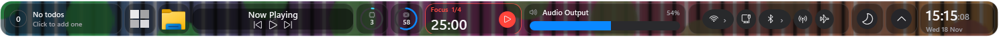
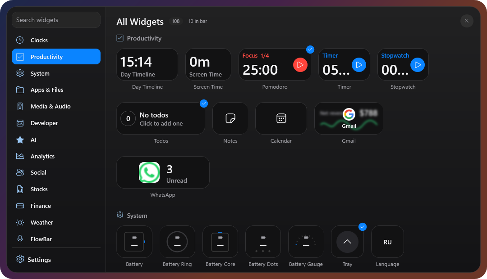

# FlowBar 2.0

Док для Windows 10 и 11: плитки приложений и виджетов внизу экрана, стеклянные темы, миниатюры окон, диктовка и подключаемые сервисы. FlowBar 2.0 — новое приложение на .NET 10 (WPF); прежняя панель 1.x осталась в ветке [`legacy-1.x`](../../tree/legacy-1.x).





## Установка

1. Скачайте `FlowBar.zip` со страницы [Releases](../../releases/latest) и распакуйте.
2. Запустите `FlowBar.exe`. Он сам устанавливается в `%LOCALAPPDATA%\Programs\FlowBar`, закрывает прежнюю панель FlowBar 1.x и запускает установленную копию. Ставить .NET отдельно не нужно.
3. Обновления: «Настройки → Общие → Проверить обновления».

Нужна Windows 10 (версия 2004 и новее) или Windows 11, 64 бита. Данные FlowBar 2.0 лежат в `%LOCALAPPDATA%\FlowBar`. Данные прежней панели (`%APPDATA%\FlowBar`) не удаляются и не переносятся.

## Что внутри

- Открытую программу можно закрепить правым щелчком по её значку → «Закрепить на панели». Значок остаётся после закрытия программы и перезапуска FlowBar. Чтобы убрать его, выберите «Открепить от панели». Ярлык программы также можно перетащить на разблокированную панель.
- 107 виджетов в категориях «Часы», «Продуктивность», «Система», «Приложения и файлы», «Медиа и звук», «Разработка», «ИИ», «Аналитика», «Соцсети», «Акции», «Финансы», «Погода», плюс диктовка FlowBar. Галерея с живыми превью, у многих виджетов несколько стилей.
- Стили дока (чёрный, белый, жидкое стекло, полночь, прозрачный), материалы (матовое стекло, призма, металл), живое стекло с перерисовкой по частоте монитора, миксер стилей и код оформления.
- Увеличение значков как в Dock на Mac, живые миниатюры нескольких окон, меню приложений со списками переходов, значки уведомлений.
- Системные виджеты: быстрые настройки (Wi-Fi, Bluetooth), звук и микшер, яркость, тема, системный трей, сеть, температура, загрузка ЦП и ОЗУ, батарея. Звук, быстрые настройки и трей закреплены в доке. В окнах Wi-Fi и Bluetooth списки сетей и устройств, у Bluetooth есть добавление устройства.
- Задачи с напоминаниями, заметки, календарь (ICS), помодоро, таймер, экранное время, число непрочитанных в WhatsApp по уведомлениям Windows.
- Диктовка: Handy или встроенный движок (GigaAM, Whisper), запись до 30 минут, помощник (Codex, Claude, Gemini) разбирает текст на задачи и заметку.
- Подключения: GitHub, LeetCode, Gmail, Linear, Supabase, выручка (Stripe, Shopify и другие), соцсети, акции, валюты, лимиты ИИ.
- Обои (Windows и Викисклад), снимок экрана с распознаванием текста, автоматизации, глобальные сочетания клавиш.
- Сервер MCP для агентов: `FlowBar.exe --mcp` (задачи и заметки).
- Интерфейс на русском и английском.

## Сборка из исходников

Нужен .NET SDK 10. Из корня репозитория:

```powershell
dotnet publish source\FlowBar.csproj -c Release -r win-x64 --self-contained true `
  -p:PublishSingleFile=true -p:IncludeNativeLibrariesForSelfExtract=true -p:EnableCompressionInSingleFile=true `
  -p:TreatWarningsAsErrors=true -o build
```

Проверки (каждая пишет `result.txt` в указанную пустую папку, успех — строка `OK`): `FlowBar.exe --smoke <папка>`, `--audit-ui`, `--check-install`, `--check-dictation`, `--check-places`, `--check-jumplist`, `--preview-glass`, `--check-live`, а также `--check-connections` (настоящие запросы к помощникам и репозиторию моделей). Подробнее — в [CLAUDE.md](CLAUDE.md).

Дизайн и набор виджетов вдохновлены Lumabar. FlowBar — самостоятельный проект, не связанный с авторами Lumabar. Логотипы сервисов в галерее принадлежат их владельцам.
